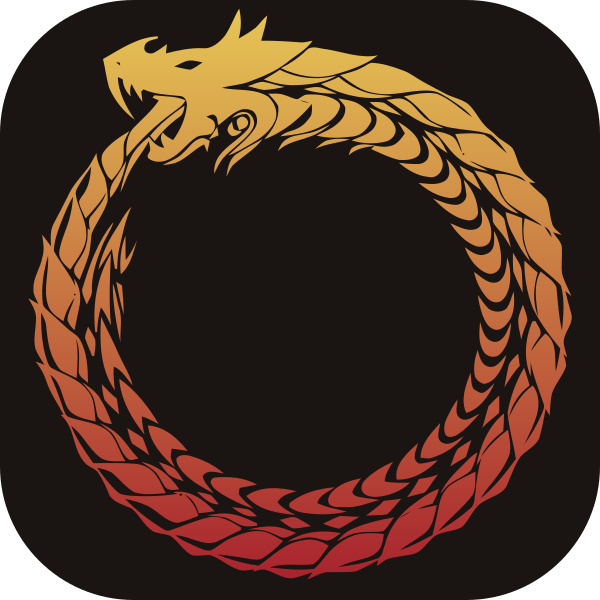

  

# SnenkBot

A desktop workflow app for streaming, built with Rust, Tauri and Svelte.

Connect Twitch, OBS Studio and VTube Studio, then combine triggers and actions into automations. SnenkBot supports chat commands, channel events, recording chapters, reusable workflows and Lua scripts, with a visual editor and run history.

## Download

Get the installers from [Releases](https://github.com/FaeyUmbrea/SnenkBot/releases).

On macOS, place **SnenkBot.app** in Applications. Public macOS builds are not yet Developer ID signed or notarized; Windows installers are not yet certificate signed.

## Getting started

Open **Settings** and choose a category. Connection and provider settings stay available even before you configure them; open an entry to set it up or change it:

- **General:** open **API server** to configure the listener and its **Consumers** section to manage named clients.
- **Streaming Services:** sign in to Twitch with your broadcaster account and, optionally, a separate bot account.
- **Broadcast Apps:** enable OBS Studio, enter its WebSocket address, and save its password in the separate credential field.
- **Devices & Tools:** configure VTube Studio and the lookup providers you use. SteamGridDB has its own key field for artwork operations.

Use **Automations** to create workflows, **Events** to inspect received events or send a test event, and **Run History** to inspect automation results. Connection settings use the same field controls across integrations. Credentials stay in your operating system's credential store; workflow data is saved locally.

The **Events** tab keeps recent received Twitch, OBS Studio, and VTube Studio events, excluding chat messages. **Replay** sends an event through its current automation and overlay dispatch paths. **Replay to…** lets you choose applicable named automations and overlay consumers for that event.

To test a consumer, open **General → API server → Send test event…**, choose the consumer and event, then press **Send**. Sample fields are prefilled and can be changed. Tests go only to that consumer and do not start automations or enter received-event history.

## Overlay API

The optional local API lets an overlay or other named consumer receive Twitch events, keep its own settings, and use enabled lookup providers. Open **Settings → General → API server** to choose a host and port and enable the listener. In its **Consumers** section, choose **Add consumer** and grant each client only the channels and provider operations it needs. Add browser origins and any secret permission names as individual entries. You can edit an existing consumer without replacing its token. Copy a newly created consumer's bearer token when it appears; the app cannot show it again. Support events are recorded automatically for the configured broadcaster, including while the HTTP listener is disabled.

See the [Overlay API reference](docs/overlay-api.md) for connection examples, permissions, history import, and recovery.

## Contributing

See [CONTRIBUTING.md](CONTRIBUTING.md). Bugs and project work are tracked in [YouTrack](https://tasks.void.monster/projects/SNENKBOT).

The [maintenance reference](https://tasks.void.monster/articles/SNENKBOT-A-4) describes the current architecture, development and release steps, and unfinished Version 1 work.

## License

SnenkBot is licensed under [GPLv3](LICENSE). Inter Tight is included under the [SIL Open Font License](assets/fonts/OFL.txt). The shared Snenk dragon symbol is CC0.
